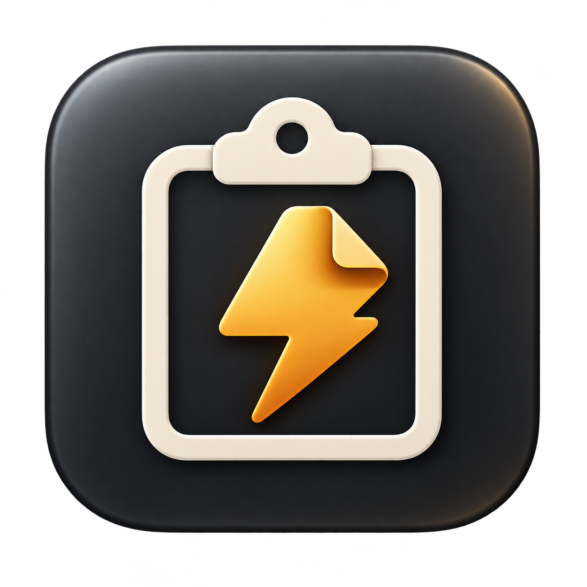

<p align="center"></p>

# SwiftClip

A lightweight, native clipboard manager for **macOS 13 and later**, built with **SwiftUI, AppKit and SQLite**. Keep useful text, images, links and file references close at hand, search your local history and paste an item back into the app you were using.

**[Download from Releases](https://github.com/MinhTam503/SwiftClip/releases)** · **[Hướng dẫn tiếng Việt](README.vi.md)** · [Report a bug](https://github.com/MinhTam503/SwiftClip/issues)

## Features

- Menu bar app; no Dock icon or main window on background startup.
- Text, multiline text, PNG/TIFF images, URLs, file URLs and supported rich-text representations.
- Search, pin/unpin, preview, delete and duplicate promotion.
- Compact popup, keyboard navigation and configurable global shortcut.
- **Auto Paste** or **Copy Only**. Auto Paste restores the destination app and sends one Command+V.
- English and Vietnamese UI, with a saved language preference and immediate switching.
- Launch at Login using `SMAppService`.
- Pause monitoring, ignore selected apps and reject marked sensitive/transient/autogenerated clipboard content.
- Local SQLite metadata, disk-backed payloads/thumbnails, paged history and configurable retention.
- No account, server, cloud sync, analytics or third-party runtime dependencies.

## Download and install

1. Open [Releases](https://github.com/MinhTam503/SwiftClip/releases), choose a version and download its `SwiftClip<version>.dmg` asset. Source archives are not the installer.
2. Open the DMG and drag **SwiftClip.app** into **Applications**.
3. Open the installed `/Applications/SwiftClip.app`. Look for the clipboard icon on the macOS menu bar.
4. Optional: verify the download against the release's `SHA256SUMS`:
   ```sh
   shasum -a 256 -c SHA256SUMS
   ```
   Run this in the folder containing the DMG and checksum file.

The DMG contains a **universal binary** for Apple Silicon and Intel. Compilation for both architectures is checked; behavior on every macOS version/device is not guaranteed.

### Gatekeeper and signing

Current public builds are **ad-hoc signed**, **not Developer ID signed and not notarized**. No paid Apple Developer account is required to build locally, but macOS may block a downloaded build.

If you trust the source and release, use the app-specific **System Settings → Privacy & Security → Open Anyway** option when macOS offers it, then confirm opening SwiftClip. Keep Gatekeeper enabled. Ad-hoc signing provides local bundle integrity; it does not establish a verified developer identity or equal Apple notarization.

For additional control, review the source and [build it yourself](#build-from-source).

## Usage

Copy something in another app, then click the menu bar icon or press **⌘⇧V**. Search the history and click an item to use it.

| Action | Default |
| --- | --- |
| Open/close clipboard popup | Command + Shift + V |
| Focus search | Command + F |
| Select previous/next item | Up / Down |
| Paste selected item | Return |
| Clear search, then close | Escape |
| Delete selected item | Command + Backspace |

Right-click an item for **Paste, Copy, Pin/Unpin, Preview or Delete**. Copy writes to the clipboard without automatic paste. Page controls browse older/newer results without keeping the entire history in RAM. Right-click the menu bar icon for Open Clipboard, Settings and Quit.

Drag the popup by its title/header area to move it. Its position stays in place as history updates during that opening; reopening uses automatic placement. Clear All keeps the history popup open after either Cancel or confirmation.

The popup attempts to avoid a focused text control using Accessibility geometry. When that metadata is unavailable it positions away from the pointer. Large editors and small screens can leave no completely separate area.

### Accessibility and Auto Paste

Auto Paste requires **System Settings → Privacy & Security → Accessibility** (the control's name may vary with macOS). Add and enable the installed `/Applications/SwiftClip.app`, then quit/reopen it if needed.

- Without permission, selected content is still copied so you can press Command+V manually.
- After replacing an **ad-hoc** build, macOS may retain the previous build's permission entry. Quit SwiftClip, remove its old entry with **−**, add the installed app with **+**, enable it and reopen.
- Native Command+V does not require a web editor to expose an AX text field. SwiftClip uses bounded focus checks and rejects recognizable secure/inappropriate controls.
- macOS does not acknowledge that an app accepted a synthetic paste. Custom web editors, protected fields and unusual focus behavior may still need manual paste. Do not assume every field or app is supported.

### Settings

- **General:** language (System / English / Tiếng Việt), Launch at Login, menu bar icon, background startup, Copy Only, close-after-selection and appearance.
- **Shortcuts:** record Open Clipboard, Focus Search and Paste Selected; restore defaults if needed. Some app-local shortcut conflicts cannot be detected by Carbon.
- **History:** 100 / 500 / 1,000 / unlimited items, capture-size cap and age retention. Pins survive automatic cleanup; Clear All includes pins and asks for confirmation.
- **Privacy:** pause monitoring, ignored bundle IDs (one per line) and polling interval (250 / 500 / 1,000 ms).

Language changes update application-owned labels, menus, errors and timestamps. **Clipboard content is never translated.** OS-owned dialogs/context menus follow macOS language settings. Timestamps are snapshots taken when the popup opens, not a real-time counter.

Launch at Login may need approval in macOS Login Items. Install the app in Applications first. The app does not create custom LaunchAgents or ask for administrator access.

## Privacy and storage

Data is stored under `~/Library/Application Support/SwiftClip/`:

- `Database/clipboard.sqlite`: indexed metadata and searchable text.
- `Payloads/`: supported original clipboard representations, including images/rich text.
- `Thumbnails/`: small, disk-backed image previews.

The app **does not encrypt this storage**. Anyone with appropriate access to your account/files can read it. It makes no network requests and does not log clipboard contents. Concealed, transient and autogenerated pasteboard types are always rejected, but **unmarked secrets cannot be identified reliably**. Pause monitoring or ignore sensitive apps; this is not a password manager.

Ignored-app attribution is best effort, based on the foreground app when polling detects a change. File URLs are references: the original files must still exist and be accessible. A copy with different representations can have a different fingerprint even if it looks identical.

The default history limit is 500; payload retention has a 1 GiB budget, except pinned entries may exceed it. A capture's size cap includes all preserved representations. Unlimited history remains paged (60 rows), not loaded at startup. Preview images are downsampled off the main thread.

## Update and uninstall

To update: quit SwiftClip, replace the app in Applications with the new version, reopen it and refresh its Accessibility entry if necessary. Replacing the app does not erase history/preferences. Each release keeps its own DMG; new builds do not overwrite previous disk images.

To uninstall: disable Launch at Login, quit SwiftClip and remove the app. To erase history as well, use Clear All History beforehand or remove `~/Library/Application Support/SwiftClip/` after quitting. The preferences domain is `com.personal.swiftclip`. Remove its Accessibility entry if desired.

## Build from source

Use a Mac with **full Xcode** and its command-line tools selected. The app targets macOS 13+, uses Swift tools 5.9+ and has no external packages. A recent Xcode with the required SDK is recommended.

```sh
git clone https://github.com/MinhTam503/SwiftClip.git
cd SwiftClip
python3 Scripts/check_localization.py
swift test --scratch-path .build/Tests
bash Scripts/build_release.sh
```

Open `SwiftClip.xcodeproj`, shared scheme **SwiftClip**, for Xcode development. The release script builds both architectures, signs ad-hoc, validates resources/signature/checksum and creates `dist/SwiftClip<version>.dmg`. A same-version rebuild receives a timestamp/suffix. It cleans `.build` after success and saves a local report in `Docs/BUILD_REPORT_<version>.md` (ignored by Git).

Optional helper commands:

```sh
bash Scripts/install_local.sh                  # newest local DMG; backs up an installed app
bash Scripts/benchmark.sh                      # isolated synthetic test; about 11 minutes
bash Scripts/benchmark.sh --short
bash Scripts/profile.sh Allocations /private/tmp/SwiftClip-Allocations.trace
bash Scripts/profile.sh Leaks /private/tmp/SwiftClip-Leaks.trace
```

Helpers can extract the newest DMG when intermediate apps were cleaned. Diagnostic runs use their own temporary database/pasteboard. Profiling uses a separate app copy with a debugger entitlement; the distributed app has no such entitlement. See [performance notes](Docs/PERFORMANCE.md), [localization](Docs/LOCALIZATION.md) and [manual acceptance](Docs/MANUAL_ACCEPTANCE.md).

## Automated builds and releases

[GitHub Actions](https://github.com/MinhTam503/SwiftClip/actions) runs publication/localization audits and tests on macOS Apple Silicon and Intel for pushes/PRs. The Release workflow tests and builds a universal DMG on a macOS runner.

- Push a matching tag such as `v1.0.4` to build and publish a GitHub Release with the DMG and `SHA256SUMS`.
- A manual Release workflow run builds a downloadable Actions artifact without publishing a release.
- Existing releases/assets are not overwritten. Use a new version/tag for a new public release.
- Only the publish job receives `contents: write`; PR jobs have read-only permissions. Actions are pinned to full commit SHAs. No signing secrets or paid certificate are required for the ad-hoc pipeline.

See [RELEASING.md](RELEASING.md) for the exact maintainer steps. Build success is not proof that permission-sensitive paste, startup and every web editor passed live acceptance tests.

## Contributing and security

Read [CONTRIBUTING.md](CONTRIBUTING.md) before sending changes. Report ordinary bugs through [Issues](https://github.com/MinhTam503/SwiftClip/issues), including version, macOS and reproduction steps. Use synthetic clipboard data and redact screenshots/logs. Never publish real clipboard history, secrets or signing keys.

For a suspected vulnerability or disclosure risk, follow [SECURITY.md](SECURITY.md) rather than opening a public issue with private data.

## License

[MIT](LICENSE). The application icon is included with this project; its generation prompt is in `Resources/ICON_PROMPT.txt`.

See [SECURITY.md](SECURITY.md) for runtime protections, storage boundaries and remaining limitations.
