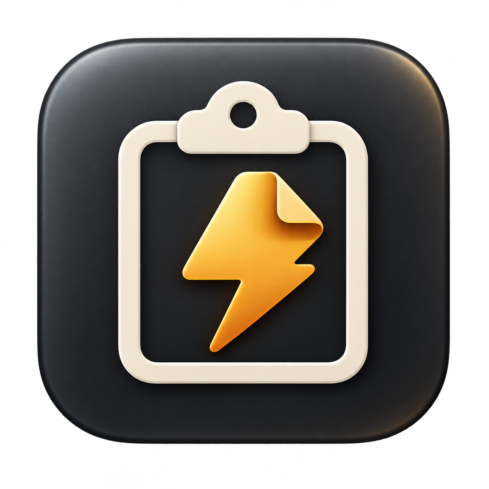

<p align="center"></p>

# SwiftClip

Trình quản lý clipboard **native cho macOS 13 trở lên**, xây dựng bằng **SwiftUI, AppKit và SQLite**. Lưu lịch sử văn bản, ảnh, liên kết và tham chiếu tệp trên máy; tìm kiếm rồi chọn lại nội dung để dán vào ứng dụng đang sử dụng.

**[Tải tại Releases](https://github.com/MinhTam503/SwiftClip/releases)** · **[English](README.md)**

## Tính năng

- Chạy trên Menu Bar, không có Dock icon hoặc cửa sổ chính khi khởi động nền.
- Văn bản nhiều dòng, PNG/TIFF, URL, file URL và các định dạng rich text được hỗ trợ.
- Tìm kiếm, ghim/bỏ ghim, xem trước, xóa và đưa nội dung trùng lên đầu.
- Popup gọn, điều hướng bàn phím, phím tắt toàn hệ thống tùy chỉnh.
- **Tự dán** hoặc **chỉ sao chép**; Auto Paste gửi một lần Command+V sau khi trả focus.
- Giao diện Anh/Việt, đổi ngay và lưu lựa chọn.
- Khởi động khi đăng nhập bằng SMAppService, tạm dừng theo dõi, bỏ qua ứng dụng.
- Dữ liệu local, ảnh và thumbnail lưu trên ổ đĩa, lịch sử phân trang.
- Không tài khoản, server, đồng bộ cloud, analytics hoặc package runtime bên ngoài.

## Cài đặt

1. Mở [Releases](https://github.com/MinhTam503/SwiftClip/releases), chọn phiên bản và tải **`SwiftClip<version>.dmg`**. File Source code không phải bộ cài.
2. Mở DMG, kéo **SwiftClip.app** vào **Applications**.
3. Mở `/Applications/SwiftClip.app`, tìm icon clipboard trên thanh Menu Bar.
4. Có thể kiểm tra checksum bằng file `SHA256SUMS` cùng phiên bản:
   ```sh
   shasum -a 256 -c SHA256SUMS
   ```
   Chạy tại thư mục chứa DMG và file checksum.

App trong DMG là **universal: Apple Silicon + Intel**. Việc build hai kiến trúc được kiểm tra; chưa đảm bảo đã thử runtime trên mọi máy/phiên bản macOS.

### Gatekeeper và chữ ký

Bản public hiện tại **ký ad-hoc, chưa ký Developer ID và chưa notarize**. Không cần Apple Developer Program trả phí để tự build, nhưng macOS có thể chặn app tải về.

Nếu bạn tin cậy source và bản release, dùng lựa chọn riêng cho app **System Settings → Privacy & Security → Open Anyway** khi macOS cung cấp, rồi xác nhận mở. Giữ Gatekeeper hoạt động. Ad-hoc chỉ kiểm tra tính toàn vẹn cục bộ, không tương đương danh tính Developer ID hay Apple notarization. Bạn cũng có thể đọc source và tự build.

## Sử dụng

Copy nội dung trong ứng dụng khác, sau đó click icon hoặc nhấn **⌘⇧V**. Tìm trong lịch sử rồi click mục muốn dùng.

| Thao tác | Mặc định |
| --- | --- |
| Mở/đóng popup | Command + Shift + V |
| Focus tìm kiếm | Command + F |
| Di chuyển lựa chọn | Mũi tên lên/xuống |
| Dán mục đã chọn | Return |
| Xóa tìm kiếm rồi đóng | Escape |
| Xóa mục | Command + Backspace |

Right-click mục để Dán, Sao chép, Ghim/Bỏ ghim, Xem trước hoặc Xóa. Sao chép chỉ ghi vào clipboard. Nút Mới hơn/Cũ hơn duyệt mỗi trang 60 mục. Right-click icon Menu Bar có Mở clipboard, Cài đặt và Thoát.

Popup ưu tiên tránh vùng ô nhập nếu đọc được tọa độ Accessibility; khi không có metadata thì tránh vùng quanh con trỏ. Màn hình nhỏ/ô soạn thảo lớn có thể không còn vị trí hoàn toàn tách biệt.

### Accessibility và Auto Paste

Vào **System Settings → Privacy & Security → Accessibility**, thêm/bật đúng **`/Applications/SwiftClip.app`**. Tên nhóm quyền có thể khác theo macOS. Thoát/mở lại app nếu cần.

- Chưa cấp quyền: nội dung vẫn được sao chép để bạn nhấn ⌘V thủ công.
- Sau khi thay bản ad-hoc, mục quyền cũ có thể không khớp chữ ký mới. Quit app, chọn SwiftClip trong danh sách quyền và nhấn **−**, nhấn **+** để thêm đúng app đã cài, bật quyền rồi mở lại.
- Command+V không đòi hỏi trình duyệt phải trả về AX text field. App kiểm tra focus có giới hạn và chặn các trường bảo mật/điều khiển không phù hợp nhận diện được.
- macOS không xác nhận ứng dụng đích đã nhận thao tác dán. Một số web editor, ô bảo vệ hoặc luồng focus đặc biệt vẫn có thể cần ⌘V thủ công; không cam kết hỗ trợ mọi ô nhập.

### Cài đặt ứng dụng

- **Chung:** ngôn ngữ System/English/Tiếng Việt, khởi động khi đăng nhập, icon, chạy nền, chỉ sao chép, đóng sau khi chọn, sáng/tối.
- **Phím tắt:** ghi phím mở clipboard, tìm kiếm, dán mục đã chọn; khôi phục mặc định. Carbon không phát hiện được mọi xung đột chỉ tồn tại trong menu của app khác.
- **Lịch sử:** 100/500/1.000/không giới hạn, kích thước mỗi lần lưu và xóa theo tuổi. Ghim được giữ khi tự dọn; Xóa tất cả gồm cả ghim và có xác nhận.
- **Quyền riêng tư:** Pause, bỏ qua bundle ID (mỗi dòng một mã) và chu kỳ kiểm tra 250/500/1.000 ms.

Đổi ngôn ngữ cập nhật nhãn/menu/lỗi/thời gian của app; **không dịch nội dung clipboard**. Hộp thoại/menu do macOS quản lý theo ngôn ngữ hệ thống. Thời gian mỗi mục cố định theo lúc mở popup, không đếm realtime.

Launch at Login có thể cần phê duyệt trong Login Items. Hãy cài vào Applications trước. App không tạo LaunchAgent riêng và không yêu cầu quyền administrator.

## Quyền riêng tư và dữ liệu

Lưu tại `~/Library/Application Support/SwiftClip/`: metadata/tìm kiếm trong `Database/clipboard.sqlite`, dữ liệu gốc được hỗ trợ trong `Payloads/`, ảnh xem nhỏ trong `Thumbnails/`.

**Ứng dụng không mã hóa thư mục dữ liệu này.** Người có quyền đọc tài khoản/tệp có thể đọc được. App không gửi dữ liệu lên mạng hoặc log nội dung clipboard. Các marker concealed/transient/autogenerated luôn bị bỏ qua, nhưng không thể xác định chắc chắn bí mật không được app nguồn đánh dấu. Dùng Pause/Ignore Apps cho ứng dụng nhạy cảm; đây không phải trình quản lý mật khẩu.

Nguồn copy được suy ra từ app foreground khi poll nên chỉ best effort nếu chuyển app rất nhanh. File URL là tham chiếu: tệp gốc phải còn tồn tại và truy cập được. Cùng nội dung nhìn thấy nhưng khác tập representation có thể tạo fingerprint khác.

Mặc định 500 mục; giới hạn payload 1 GiB, mục ghim có thể vượt. Giới hạn mỗi lần lưu tính tất cả representation được giữ. Không giới hạn vẫn phân trang và không tải toàn bộ history lúc khởi động. Thumbnail/preview được downsample nền.

## Cập nhật / gỡ app

Quit, thay app trong Applications, mở lại và cấp lại Accessibility nếu chữ ký không khớp. Lịch sử/preferences được giữ khi thay app. Các phiên bản DMG không ghi đè nhau.

Gỡ app: tắt Launch at Login, Quit rồi xóa ứng dụng. Muốn xóa lịch sử, dùng Xóa tất cả trước hoặc xóa `~/Library/Application Support/SwiftClip/` sau khi Quit. Preferences domain: `com.personal.swiftclip`. Có thể xóa mục quyền Accessibility riêng nếu muốn.

## Build và test

Cần Mac với **full Xcode** và command-line tools đã chọn; Swift tools 5.9+, SDK phù hợp, target macOS 13+. Không dùng dependency bên ngoài.

```sh
git clone https://github.com/MinhTam503/SwiftClip.git
cd SwiftClip
python3 Scripts/check_localization.py
swift test --scratch-path .build/Tests
bash Scripts/build_release.sh
```

Hoặc mở `SwiftClip.xcodeproj`, scheme dùng chung **SwiftClip**. Script build universal Release, ký ad-hoc, kiểm tra resource/chữ ký/checksum rồi tạo DMG có version trong `dist/`. Build lại cùng version sẽ thêm timestamp/suffix. `.build` được dọn sau thành công; báo cáo local nằm ở Docs và không push Git.

`Scripts/install_local.sh` cài DMG local mới nhất, backup app cũ. `Scripts/benchmark.sh` chạy tải tổng hợp riêng khoảng 11 phút; thêm `--short` cho bài nhanh. `Scripts/profile.sh Allocations ...` và `Leaks ...` dùng bản sao profiling có quyền debugger; app phát hành không có entitlement này. Helper tự giải nén DMG nếu APP trung gian đã dọn.

Xem [hiệu năng](Docs/PERFORMANCE.md), [localization](Docs/LOCALIZATION.md), [kiểm thử thủ công](Docs/MANUAL_ACCEPTANCE.md).

## GitHub Actions / Release

[Actions](https://github.com/MinhTam503/SwiftClip/actions) audit/test trên macOS Apple Silicon và Intel khi push/PR. Release workflow build DMG universal:

- Push tag khớp version, ví dụ `v1.0.4`, để tạo GitHub Release với DMG và SHA256SUMS.
- Chạy thủ công chỉ tạo Actions artifact, không publish release.
- Không ghi đè release/asset cũ; tăng version/tag cho bản mới.
- Chỉ job publish có quyền ghi nội dung repo. Job PR chỉ đọc; Actions pin theo commit SHA; không cần signing secrets cho pipeline ad-hoc.

Hướng dẫn maintainer: [RELEASING.md](RELEASING.md). Build/test tự động không thay thế kiểm tra paste có quyền, startup sau restart và từng web editor.

## Đóng góp / bảo mật / license

Đọc [CONTRIBUTING.md](CONTRIBUTING.md), báo lỗi qua [Issues](https://github.com/MinhTam503/SwiftClip/issues) kèm version/macOS/các bước tái hiện. Chỉ dùng dữ liệu thử, che thông tin screenshot/log; không đăng lịch sử clipboard, token hoặc khóa ký. Vấn đề bảo mật xem [SECURITY.md](SECURITY.md).

License [MIT](LICENSE). Icon được kèm trong dự án, prompt tạo nằm ở `Resources/ICON_PROMPT.txt`.

Xem [SECURITY.md](SECURITY.md) về bảo vệ runtime, giới hạn lưu trữ và rủi ro còn lại.

Kéo vùng tiêu đề SwiftClip để di chuyển popup. Vị trí được giữ khi danh sách cập nhật trong lần mở đó; mở lại sẽ tự chọn vị trí tránh ô nhập. Xóa tất cả hoặc hủy xác nhận đều giữ popup danh sách mở.

Mỗi lần mở popup sẽ đánh dấu mục đầu tiên đang hiển thị (ghim trước, rồi lịch sử mới nhất), con trỏ nhập vẫn ở ô tìm kiếm. Đánh dấu không tự dán; cần Enter hoặc click. Đổi từ khóa chọn kết quả đầu tiên, còn cập nhật nền giữ lựa chọn đang điều hướng.
